# Tahap 1 — Analisis Kebutuhan dan Rancangan Arsitektur

Dokumen ini adalah keluaran Tahap 1 sesuai `rules.md` Bagian 18. Belum ada kode aplikasi yang ditulis. Semua keputusan di sini menjadi acuan Tahap 2 dan seterusnya; perubahan setelah disetujui dicatat di bagian [Riwayat perubahan](#16-riwayat-perubahan).

Daftar isi:

1. [Ringkasan kebutuhan bisnis](#1-ringkasan-kebutuhan-bisnis)
2. [Fitur MVP dan fase 2](#2-fitur-mvp-dan-fase-2)
3. [Lingkungan dan keputusan teknis](#3-lingkungan-dan-keputusan-teknis)
4. [Arsitektur aplikasi](#4-arsitektur-aplikasi)
5. [Struktur folder](#5-struktur-folder)
6. [ERD dan relasi database](#6-erd-dan-relasi-database)
7. [Daftar halaman dan role](#7-daftar-halaman-dan-role)
8. [Endpoint JSON pengerjaan ujian](#8-endpoint-json-pengerjaan-ujian)
9. [Matriks hak akses](#9-matriks-hak-akses)
10. [Diagram status](#10-diagram-status)
11. [Alur kerja HR dan kandidat](#11-alur-kerja-hr-dan-kandidat)
12. [Aturan bisnis yang diturunkan](#12-aturan-bisnis-yang-diturunkan)
13. [Risiko teknis dan keamanan](#13-risiko-teknis-dan-keamanan)
14. [Rencana implementasi bertahap](#14-rencana-implementasi-bertahap)
15. [Keputusan yang perlu dikonfirmasi](#15-keputusan-yang-perlu-dikonfirmasi)
16. [Riwayat perubahan](#16-riwayat-perubahan)

---

## 1. Ringkasan kebutuhan bisnis

Tim HR membutuhkan satu sistem untuk menyaring calon karyawan melalui **pembelajaran** dan **pengujian**, lalu mengevaluasi mereka berdasarkan beberapa kriteria.

**Masalah yang diselesaikan**

- Kandidat dari beberapa gelombang rekrutmen, posisi, dan departemen perlu dibekali materi yang sama secara terukur.
- Ujian harus adil: waktu dikendalikan server, soal dan kunci tidak bocor, riwayat pengerjaan tidak bisa diubah.
- HR butuh gambaran utuh per kandidat (nilai ujian, progres belajar, wawancara, catatan), bukan satu angka, dan keputusan akhir tetap di tangan manusia.

**Pengguna**

| Pengguna    | Kebutuhan utama                                                                                  |
| ----------- | ------------------------------------------------------------------------------------------------ |
| Super Admin | Mengelola akun HR, menugaskan HR ke gelombang, konfigurasi sistem, melihat semua data, privasi.  |
| HR          | Mengelola gelombang, kandidat, materi, bank soal, ujian; menilai; mengevaluasi; membuat laporan. |
| Kandidat    | Belajar materi yang ditugaskan, mengerjakan ujian dengan nyaman (juga di ponsel), melihat hasil. |

**Ukuran keberhasilan MVP**

- HR dapat menjalankan satu gelombang rekrutmen dari awal sampai keputusan akhir tanpa alat lain.
- Kandidat dapat mengerjakan ujian di layar 360 px, refresh di tengah ujian tanpa kehilangan jawaban.
- Tidak ada jalur bagi kandidat untuk melihat kunci jawaban, data kandidat lain, atau ID internal.

## 2. Fitur MVP dan fase 2

### MVP

| Domain        | Fitur                                                                                                                                                                                                                        |
| ------------- | ---------------------------------------------------------------------------------------------------------------------------------------------------------------------------------------------------------------------------- |
| Akses         | Login, logout, lupa password, 2FA untuk Super Admin dan HR, aktivasi akun kandidat lewat tautan, persetujuan pemrosesan data, kelola akun HR, penugasan HR ke gelombang, nonaktifkan akun.                                   |
| Rekrutmen     | Master departemen dan posisi; gelombang (draft/open/closed); kandidat (CRUD, cari, filter, pagination server, nonaktifkan); lamaran per gelombang; tahap rekrutmen + riwayat; catatan internal; form evaluasi + rekomendasi. |
| Pembelajaran  | Program (draft/published/archived), modul dan materi berurutan (artikel, PDF, gambar, video embed/unggah, tautan), wajib/opsional, penugasan program, progres per materi, akses file privat.                                 |
| Bank soal     | Kategori; soal 6 jenis (MC, multi-select, benar/salah, isian singkat, esai, studi kasus); cari dan filter; arsip; riwayat pemakaian; versioning.                                                                             |
| Ujian         | Konfigurasi lengkap (Bagian 8 rules), penugasan dengan jadwal khusus per individu, kunci ujian setelah ada attempt, duplikasi ujian.                                                                                         |
| Pengerjaan    | Mulai ujian dengan transaction dan lock, snapshot, autosave, tandai ragu, timer server, pemulihan setelah refresh, antrean simpan di klien, submit idempotent, auto-submit (scheduler + saat akses), log peristiwa.          |
| Penilaian     | Penilaian otomatis objektif, antrean penilaian manual, nilai berbobot dan per kategori, nilai sementara vs final, kebijakan percobaan, kebijakan publikasi, audit perubahan nilai.                                           |
| Dashboard     | Dashboard HR dengan filter (dalam lingkup), dashboard kandidat.                                                                                                                                                              |
| Laporan       | Laporan Bagian 12 rules, ekspor CSV lewat queue, unduhan hanya oleh peminta, dicatat di audit log.                                                                                                                           |
| Privasi/audit | Audit log, retensi + anonimisasi terjadwal, permintaan penghapusan data oleh kandidat.                                                                                                                                       |

### Fase 2 (database disiapkan, fitur belum dibuat)

| Fitur                                     | Persiapan di MVP                                                                                                                    |
| ----------------------------------------- | ----------------------------------------------------------------------------------------------------------------------------------- |
| Impor kandidat dari CSV                   | Pembuatan kandidat sudah lewat satu action yang bisa dipanggil berulang.                                                            |
| Undangan dan notifikasi email             | Aktivasi akun sudah memakai token; di fase 2 tinggal dikirim lewat email (queue).                                                   |
| Ekspor Excel                              | Ekspor memakai kelas generator per format; tabel `report_exports` punya kolom `format`.                                             |
| Perbandingan antar-gelombang              | Semua data hasil sudah memiliki relasi ke gelombang.                                                                                |
| Aturan durasi tonton video                | `material_progress` punya kolom `watched_seconds` (belum dipakai).                                                                  |
| Nilai parsial lanjutan                    | Aturan penilaian disimpan per soal di snapshot (`scoring_rule`), bukan hardcode.                                                    |
| Status rekrutmen yang dapat dikonfigurasi | Tahap disimpan sebagai string berindeks; enum PHP menjadi satu-satunya sumber nilai sehingga bisa diganti tabel tanpa migrasi data. |

## 3. Lingkungan dan keputusan teknis

### Lingkungan yang sudah terpasang

| Komponen     | Versi / pilihan                                                                                                               |
| ------------ | ----------------------------------------------------------------------------------------------------------------------------- |
| Fondasi      | Laravel React Starter Kit (Inertia 3, React 19, TypeScript, Tailwind 4, shadcn/ui)                                            |
| Framework    | Laravel 13.x, PHP 8.3.20                                                                                                      |
| Autentikasi  | Laravel Fortify: login, lupa password, 2FA, konfirmasi password. Registrasi publik, verifikasi email, dan passkeys dimatikan. |
| Database     | MySQL 5.7.33 (Laragon) — dev `biozatix_lms`, test `recruitment_lms_testing`                                                   |
| Routing FE   | Laravel Wayfinder (fungsi route bertipe untuk TypeScript)                                                                     |
| Build & lint | Vite+ (`vp build`, `vp check` = Oxlint + formatter, `vp test` = Vitest)                                                       |
| Tes backend  | PHPUnit 12 (bawaan starter kit)                                                                                               |

### Keputusan teknis (non-kritis, dipilih default yang sederhana)

| No  | Keputusan                                                                                                                                                                                                                          | Alasan                                                                                                              |
| --- | ---------------------------------------------------------------------------------------------------------------------------------------------------------------------------------------------------------------------------------- | ------------------------------------------------------------------------------------------------------------------- |
| T1  | Role disimpan sebagai kolom enum `users.role` (`super_admin`, `hr`, `candidate`), tanpa paket permission.                                                                                                                          | Hanya tiga role tetap; otorisasi detail ada di Policy.                                                              |
| T2  | Tes backend memakai **PHPUnit** (rules mengizinkan Pest atau PHPUnit).                                                                                                                                                             | Sudah terpasang, 29 tes bawaan lulus.                                                                               |
| T3  | Linter frontend memakai **Oxlint lewat `vp check`** sebagai pengganti ESLint.                                                                                                                                                      | Bawaan starter kit, setara fungsinya. Disetujui.                                                                    |
| T4  | Tes komponen memakai **`vp test` (Vitest)** + React Testing Library; E2E memakai **Playwright**.                                                                                                                                   | Sesuai rules.                                                                                                       |
| T5  | Kode tetap kompatibel dengan **MySQL 5.7** (lihat batasan di bawah). Produksi disarankan MySQL 8 / MariaDB 10.6+.                                                                                                                  | Disetujui; menjaga project lain di Laragon.                                                                         |
| T6  | Koneksi database diset `timezone = +00:00`; `APP_TIMEZONE=UTC`; konversi ke Asia/Jakarta hanya di presentasi (Resource + helper frontend).                                                                                         | Rules Bagian 3.                                                                                                     |
| T7  | Sanitasi HTML memakai **`symfony/html-sanitizer`** dengan allowlist tag; editor teks kaya di frontend memakai **TipTap**.                                                                                                          | Dipelihara aktif, konfigurasi eksplisit.                                                                            |
| T8  | `public_id` bertipe ULID `CHAR(26)` lewat trait bersama `HasPublicId` (memakai `HasUlids` + `uniqueIds()` + `getRouteKeyName()`).                                                                                                  | Rules Bagian 13.                                                                                                    |
| T9  | Teks antarmuka disimpan di kamus TypeScript `resources/js/i18n/id.ts` dengan helper `t()` bertipe; pesan backend di `lang/id/*.php`.                                                                                               | Tanpa library tambahan; kunci yang salah tertangkap `tsc`.                                                          |
| T10 | Departemen dan posisi menjadi **tabel master**, bukan teks bebas.                                                                                                                                                                  | Dipakai di gelombang, program, penugasan, dan filter laporan; mencegah variasi penulisan.                           |
| T11 | Aktivasi akun kandidat: HR membuat akun → sistem membuat **tautan aktivasi** (token reset password, berlaku 72 jam) yang ditampilkan sekali untuk disalin HR.                                                                      | Email baru fase 2; HR tidak pernah mengetahui password kandidat. Lihat [K1](#15-keputusan-yang-perlu-dikonfirmasi). |
| T12 | Penugasan ke "posisi" atau "gelombang" dimaterialisasi saat itu juga menjadi baris per kandidat; kandidat yang ditambahkan kemudian **tidak** ikut otomatis (HR dapat menjalankan ulang penugasan; baris yang sudah ada dilewati). | Rules Bagian 6 dan 8: baris per kandidat. Perilaku eksplisit, mudah diaudit.                                        |

### Batasan MySQL 5.7 dan cara mengatasinya

| Batasan                                                                    | Dampak                             | Solusi                                                                                                      |
| -------------------------------------------------------------------------- | ---------------------------------- | ----------------------------------------------------------------------------------------------------------- |
| Tidak ada partial/filtered unique index                                    | "Satu attempt aktif per penugasan" | Kolom generated `active_assignment_id = IF(status='in_progress', exam_assignment_id, NULL)` + unique index. |
| `CHECK` constraint diabaikan                                               | Validasi rentang nilai di database | Divalidasi di Form Request/action; tes memastikan batasnya.                                                 |
| Tidak ada window function                                                  | Memilih attempt tertinggi/terakhir | Kolom cache `exam_assignments.effective_attempt_id` diperbarui saat attempt menjadi final.                  |
| Panjang index utf8mb4 dibatasi 767 byte (tergantung `innodb_large_prefix`) | Index pada string panjang          | `Schema::defaultStringLength(191)` hanya jika diperlukan; kolom berindeks dibuat pendek.                    |

## 4. Arsitektur aplikasi

**Modular monolith** dalam satu project Laravel. Request HTTP masuk ke controller tipis, yang memanggil action/service domain. Inertia mengirim props bertipe ke React; khusus halaman ujian, React berkomunikasi lewat endpoint JSON.

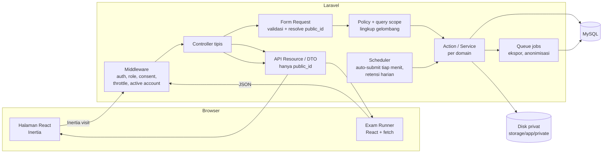

**Domain dan tanggung jawab**

| Domain         | Isi                                                                                                   |
| -------------- | ----------------------------------------------------------------------------------------------------- |
| `Shared`       | Trait `HasPublicId`, sanitasi HTML, audit log, helper waktu, enum `Role`.                             |
| `Access`       | User, peran, penugasan HR ke gelombang, persetujuan data, aktivasi akun, permintaan penghapusan data. |
| `Candidates`   | Departemen, posisi, gelombang, profil kandidat, lamaran, tahap + riwayat, catatan internal, evaluasi. |
| `Learning`     | Program, modul, materi, file materi, penugasan program, progres.                                      |
| `QuestionBank` | Kategori, soal, pilihan, jawaban diterima, versioning.                                                |
| `Exams`        | Ujian, soal ujian, penugasan ujian, mesin attempt, snapshot, penilaian, publikasi hasil.              |
| `Reporting`    | Query dashboard dan laporan, ekspor CSV, retensi.                                                     |

**Aturan lapisan**

- Controller: menerima Form Request, memanggil `authorize`, memanggil satu action, mengembalikan Inertia response / JSON / redirect. Tanpa query bisnis.
- Action: satu operasi bisnis (`StartAttempt`, `SubmitAttempt`, `ChangeApplicationStage`, ...), mengelola transaction dan lock.
- Query object/scope: semua query yang membutuhkan lingkup HR memakai scope `visibleTo(User $user)` di model terkait; Policy memakai scope yang sama sehingga tidak ada dua sumber kebenaran.
- Resource: satu-satunya jalan data ke frontend; `id` = `public_id`.

## 5. Struktur folder

Hanya folder utama; file dibuat per tahap.

```text
app/
├── Domain/
│   ├── Shared/        Concerns/HasPublicId.php, Enums/Role.php, Support/HtmlSanitizer.php, Audit/
│   ├── Access/        Models/ Actions/ Policies/ Enums/
│   ├── Candidates/    Models/ Actions/ Policies/ Enums/ Queries/
│   ├── Learning/      Models/ Actions/ Policies/ Enums/ Queries/
│   ├── QuestionBank/  Models/ Actions/ Policies/ Enums/
│   ├── Exams/         Models/ Actions/ Policies/ Enums/ Grading/ Snapshots/ Jobs/
│   └── Reporting/     Queries/ Exports/ Jobs/
├── Http/
│   ├── Controllers/
│   │   ├── Admin/         (Super Admin + HR, prefix /admin)
│   │   ├── Candidate/     (halaman kandidat)
│   │   ├── ExamRunner/    (endpoint JSON pengerjaan)
│   │   └── Settings/      (bawaan starter kit)
│   ├── Middleware/        EnsureRole, EnsureAccountActive, EnsureConsentGiven
│   ├── Requests/<Domain>/
│   └── Resources/<Domain>/
├── Console/Commands/      (perintah buat Super Admin, dsb.)
└── Providers/
database/
├── migrations/
├── factories/
└── seeders/               DatabaseSeeder (produksi), Demo/DemoSeeder (hanya non-produksi)
lang/id/                   auth.php, validation.php, passwords.php, ...
resources/js/
├── pages/
│   ├── auth/              (bawaan + activate.tsx, consent.tsx)
│   ├── settings/          (bawaan)
│   ├── admin/             dashboard, campaigns/, candidates/, programs/, questions/, exams/, grading/, reports/, users/, system/
│   └── candidate/         dashboard, learn/, exams/, attempts/, history, privacy
├── components/
│   ├── ui/                (shadcn, bawaan)
│   ├── app/               shell, sidebar, data-table, status-badge, empty-state, confirm-dialog
│   ├── <domain>/          komponen khusus domain (mis. exam-runner/)
├── hooks/                 use-server-clock, use-autosave-queue, ...
├── lib/icons.ts           peta ikon Lucide untuk konsep berulang
├── i18n/id.ts             kamus teks UI
└── types/                 models.ts (tipe Resource), pages.ts (props per halaman), shared.ts
tests/
├── Feature/<Domain>/      tes HTTP, otorisasi, aturan bisnis
├── Unit/                  grader, snapshot, perhitungan nilai
├── Browser/ (Playwright)  e2e/
resources/js/**/*.test.tsx tes komponen (timer, navigasi soal, indikator simpan, dialog submit)
docs/                      dokumen tahap, matriks akses
```

Model domain berada di `app/Domain/<Domain>/Models`; factory dihubungkan lewat atribut `#[UseFactory]`; Policy ditemukan otomatis karena berada di `../Policies` relatif terhadap model.

## 6. ERD dan relasi database

Konvensi untuk semua tabel di bawah:

- `id` BIGINT auto-increment (internal), `public_id` CHAR(26) ULID unik untuk tabel yang diakses frontend.
- `created_at`, `updated_at` di semua tabel kecuali tabel log yang hanya punya `created_at`.
- Waktu bertipe `TIMESTAMP`/`DATETIME` dalam UTC.
- Nilai/poin: `DECIMAL(8,2)` untuk poin, `DECIMAL(6,2)` untuk persentase 0–100.
- Tidak memakai soft delete. Akun dinonaktifkan lewat `is_active`, data pribadi dihapus lewat anonimisasi, data lain memakai status arsip, dan foreign key `RESTRICT` mencegah penghapusan data yang masih dirujuk riwayat.

### 6.1 Akses dan rekrutmen

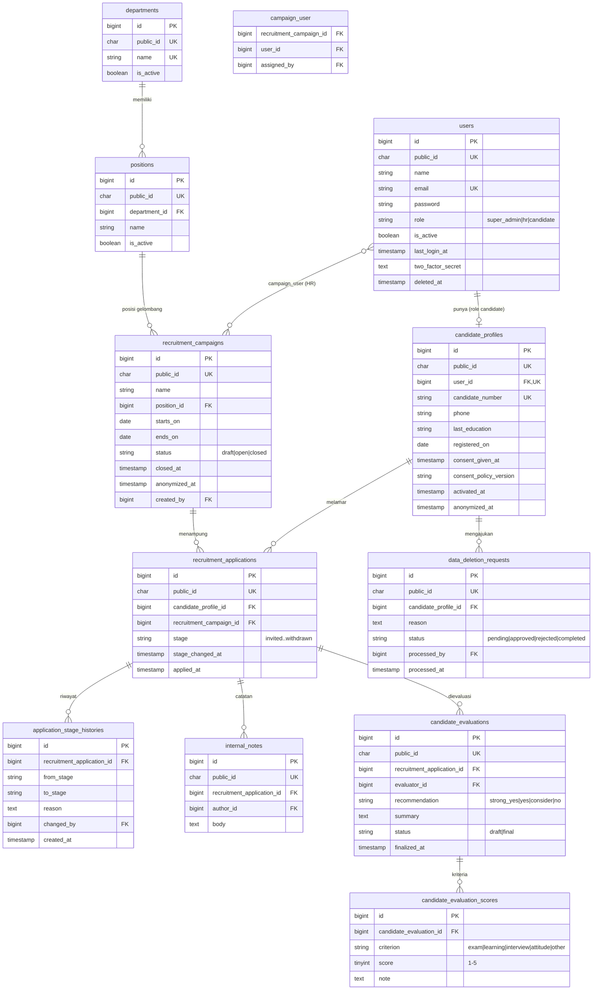

Constraint penting: `UNIQUE(candidate_profile_id, recruitment_campaign_id)` pada lamaran; `UNIQUE(recruitment_campaign_id, user_id)` pada `campaign_user`; `UNIQUE(department_id, name)` pada posisi.

### 6.2 Pembelajaran

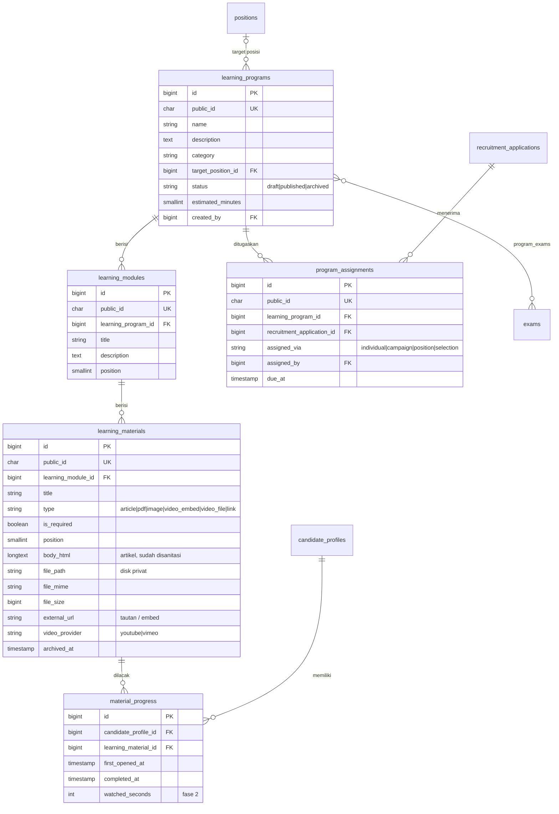

Constraint penting: `UNIQUE(learning_program_id, recruitment_application_id)`; `UNIQUE(candidate_profile_id, learning_material_id)`. Progres disimpan per kandidat (bukan per lamaran), sehingga materi yang sama tidak perlu dipelajari ulang di gelombang lain. Persentase progres = materi wajib aktif yang `completed_at`-nya terisi ÷ jumlah materi wajib aktif saat ini; dihitung dengan agregasi query.

### 6.3 Bank soal dan ujian

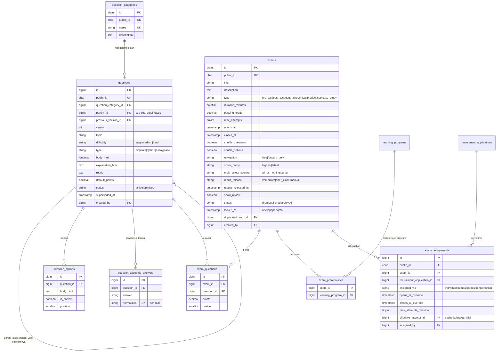

Constraint penting: `UNIQUE(exam_id, question_id)`; `UNIQUE(exam_id, recruitment_application_id)`; `UNIQUE(question_id, normalized)`.

**Versioning soal (copy-on-write).** Soal yang belum pernah dipakai di ujian terkunci boleh diedit langsung. Jika soal sudah dipakai di ujian yang `locked_at`-nya terisi, menyimpan perubahan membuat **baris soal baru** (`version + 1`, `previous_version_id` menunjuk ke versi lama), lalu versi lama diberi `superseded_at` dan tidak tampil di daftar bank soal. Ujian terkunci tetap menunjuk ke versi lama, sehingga semua kandidat dalam ujian yang sama mendapat soal yang sama. Ujian yang belum terkunci ditawari untuk mengganti ke versi baru. Snapshot di attempt tetap dibuat sebagai lapisan perlindungan kedua.

### 6.4 Pengerjaan dan penilaian

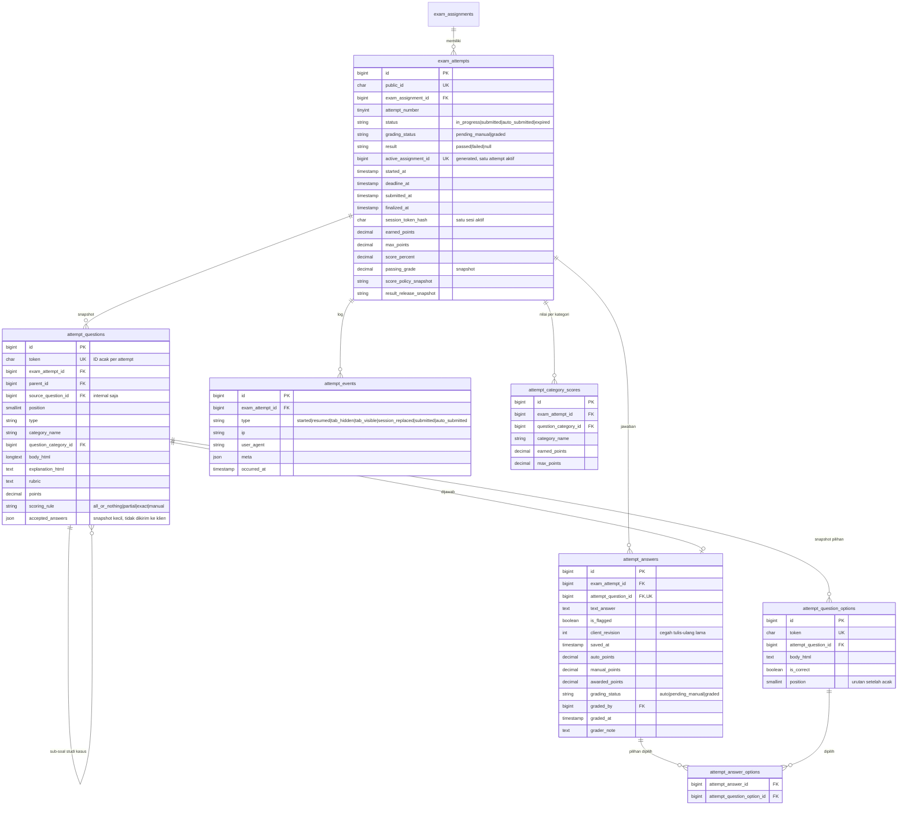

Constraint penting: `UNIQUE(exam_assignment_id, attempt_number)`; `UNIQUE(active_assignment_id)` (kolom generated); `UNIQUE(exam_attempt_id, attempt_question_id)` pada jawaban; `UNIQUE(attempt_answer_id, attempt_question_option_id)`. Jawaban disimpan satu baris per soal (bukan JSON besar).

### 6.5 Sistem dan audit

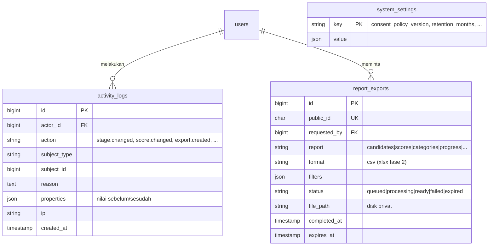

Tabel bawaan Laravel tetap: `sessions`, `cache`, `cache_locks`, `jobs`, `job_batches`, `failed_jobs`, `password_reset_tokens`.

### 6.6 Index utama (filter dan relasi)

| Tabel                      | Index                                                             |
| -------------------------- | ----------------------------------------------------------------- |
| `users`                    | `(role, is_active)`                                               |
| `recruitment_applications` | `(recruitment_campaign_id, stage)`, `(candidate_profile_id)`      |
| `recruitment_campaigns`    | `(status, starts_on)`, `(position_id)`                            |
| `questions`                | `(status, superseded_at, question_category_id, difficulty, type)` |
| `exams`                    | `(status, closes_at)`                                             |
| `exam_assignments`         | `(recruitment_application_id)`                                    |
| `exam_attempts`            | `(status, deadline_at)` untuk job auto-submit; `(grading_status)` |
| `attempt_answers`          | `(grading_status)` untuk antrean penilaian manual                 |
| `material_progress`        | `(learning_material_id, completed_at)`                            |
| `activity_logs`            | `(subject_type, subject_id)`, `(actor_id, created_at)`            |

## 7. Daftar halaman dan role

Legenda: **SA** = Super Admin, **HR** = HR, **K** = Kandidat. ✓ = boleh; **L** = hanya data dalam gelombang yang ditugaskan; **S** = hanya miliknya sendiri; – = tidak boleh (403/404).

### Umum dan autentikasi

| Halaman                      | URL                          | SA  | HR  | K   |
| ---------------------------- | ---------------------------- | --- | --- | --- |
| Login, lupa/reset password   | `/login`, `/forgot-password` | ✓   | ✓   | ✓   |
| Tantangan 2FA                | `/two-factor-challenge`      | ✓   | ✓   | –   |
| Aktivasi akun (set password) | `/activate/{token}`          | –   | –   | ✓   |
| Persetujuan pemrosesan data  | `/consent`                   | –   | –   | ✓   |
| Pengaturan profil & password | `/settings/*`                | ✓   | ✓   | ✓   |
| Pengaturan 2FA               | `/settings/security`         | ✓   | ✓   | –   |

### Administrasi (prefix `/admin`)

| Halaman                                          | URL                                | SA  | HR                                                                           |
| ------------------------------------------------ | ---------------------------------- | --- | ---------------------------------------------------------------------------- |
| Dashboard HR                                     | `/admin`                           | ✓   | L                                                                            |
| Gelombang: daftar, buat, ubah, detail            | `/admin/campaigns/...`             | ✓   | L (lihat & ubah yang ditugaskan; buat baru = otomatis ditugaskan ke pembuat) |
| Penugasan HR ke gelombang                        | `/admin/campaigns/{c}/team`        | ✓   | –                                                                            |
| Departemen & posisi                              | `/admin/positions`                 | ✓   | ✓                                                                            |
| Kandidat: daftar, buat, ubah, detail             | `/admin/candidates/...`            | ✓   | L                                                                            |
| Lamaran: tahap, riwayat, catatan, evaluasi       | `/admin/applications/{a}`          | ✓   | L                                                                            |
| Program: daftar, buat, susun modul & materi      | `/admin/programs/...`              | ✓   | ✓                                                                            |
| Penugasan program                                | `/admin/programs/{p}/assign`       | ✓   | L (target hanya lamaran dalam lingkup)                                       |
| Kategori soal                                    | `/admin/question-categories`       | ✓   | ✓                                                                            |
| Bank soal: daftar, buat, ubah, riwayat pemakaian | `/admin/questions/...`             | ✓   | ✓                                                                            |
| Ujian: daftar, buat, ubah, soal, duplikasi       | `/admin/exams/...`                 | ✓   | ✓                                                                            |
| Penugasan ujian & jadwal khusus                  | `/admin/exams/{e}/assignments`     | ✓   | L                                                                            |
| Monitor attempt ujian                            | `/admin/exams/{e}/attempts`        | ✓   | L                                                                            |
| Antrean penilaian manual                         | `/admin/grading`                   | ✓   | L                                                                            |
| Penilaian satu attempt                           | `/admin/attempts/{t}/grade`        | ✓   | L                                                                            |
| Publikasi hasil ujian (manual)                   | aksi di `/admin/exams/{e}`         | ✓   | ✓                                                                            |
| Laporan & ekspor                                 | `/admin/reports`, `/admin/exports` | ✓   | L (unduh hanya ekspor miliknya)                                              |
| Akun pengguna (SA & HR)                          | `/admin/users`                     | ✓   | –                                                                            |
| Konfigurasi sistem (versi kebijakan, retensi)    | `/admin/system`                    | ✓   | –                                                                            |
| Permintaan penghapusan data                      | `/admin/data-requests`             | ✓   | –                                                                            |
| Audit log                                        | `/admin/audit-log`                 | ✓   | –                                                                            |

### Kandidat

| Halaman                               | URL                              | K   |
| ------------------------------------- | -------------------------------- | --- |
| Dashboard kandidat                    | `/dashboard`                     | S   |
| Profil (data diri yang boleh diubah)  | `/profile`                       | S   |
| Program saya                          | `/learn`                         | S   |
| Detail program (modul & materi)       | `/learn/{program}`               | S   |
| Materi                                | `/learn/{program}/materials/{m}` | S   |
| Ujian saya                            | `/exams`                         | S   |
| Instruksi ujian & tombol mulai        | `/exams/{assignment}`            | S   |
| Pengerjaan ujian                      | `/attempts/{attempt}`            | S   |
| Hasil & pembahasan (sesuai publikasi) | `/attempts/{attempt}/result`     | S   |
| Riwayat                               | `/history`                       | S   |
| Privasi & permintaan penghapusan data | `/privacy`                       | S   |

Super Admin dan HR yang membuka URL kandidat diarahkan ke `/admin`; kandidat yang membuka `/admin/*` mendapat 404.

## 8. Endpoint JSON pengerjaan ujian

Semua memakai sesi web + CSRF, `public_id` attempt di URL, ID soal/pilihan berupa token acak per attempt, dan rate limit khusus.

| Metode | URL                                   | Fungsi                                                                                 | Rate limit |
| ------ | ------------------------------------- | -------------------------------------------------------------------------------------- | ---------- |
| POST   | `/exams/{assignment}/start`           | Mulai atau lanjutkan attempt (Inertia redirect ke runner)                              | 10/menit   |
| GET    | `/attempts/{attempt}/state`           | Soal (tanpa kunci), jawaban tersimpan, tanda ragu, posisi, `deadline_at`, `server_now` | 30/menit   |
| PUT    | `/attempts/{attempt}/answers/{token}` | Autosave satu jawaban (`client_revision` menolak data lama)                            | 120/menit  |
| GET    | `/attempts/{attempt}/clock`           | Sinkronisasi waktu (`server_now`, `deadline_at`, status)                               | 30/menit   |
| POST   | `/attempts/{attempt}/events`          | Log pindah tab / kembali aktif                                                         | 60/menit   |
| POST   | `/attempts/{attempt}/submit`          | Submit idempotent; mengembalikan status final yang sama jika diulang                   | 10/menit   |

Setiap endpoint menjalankan "cek kedaluwarsa saat akses": jika `now() >= deadline_at` dan status masih `in_progress`, attempt di-auto-submit dulu, lalu respons memberi tahu klien.

## 9. Matriks hak akses

Legenda sama dengan Bagian 7. Matriks ini menjadi dasar tes otorisasi (setiap sel = minimal satu tes; sel **L** diuji untuk gelombang yang ditugaskan dan yang **tidak** ditugaskan → 404).

| Domain    | Aksi                                               | SA            | HR                 | K                                                         |
| --------- | -------------------------------------------------- | ------------- | ------------------ | --------------------------------------------------------- |
| Akun      | Kelola akun SA/HR (buat, ubah, nonaktifkan)        | ✓             | –                  | –                                                         |
| Akun      | Ubah profil & password sendiri                     | ✓             | ✓                  | ✓                                                         |
| Akun      | Aktifkan/kelola 2FA sendiri                        | ✓             | ✓                  | –                                                         |
| Sistem    | Ubah konfigurasi (kebijakan privasi, retensi)      | ✓             | –                  | –                                                         |
| Sistem    | Lihat audit log                                    | ✓             | –                  | –                                                         |
| Gelombang | Lihat daftar & detail                              | ✓             | L                  | –                                                         |
| Gelombang | Buat                                               | ✓             | ✓                  | –                                                         |
| Gelombang | Ubah, buka, tutup                                  | ✓             | L                  | –                                                         |
| Gelombang | Tugaskan/lepas HR                                  | ✓             | –                  | –                                                         |
| Master    | Kelola departemen & posisi                         | ✓             | ✓                  | –                                                         |
| Kandidat  | Lihat daftar, cari, filter                         | ✓             | L                  | –                                                         |
| Kandidat  | Buat kandidat + lamaran di gelombang               | ✓             | L                  | –                                                         |
| Kandidat  | Ubah data, nonaktifkan                             | ✓             | L                  | –                                                         |
| Kandidat  | Buat tautan aktivasi ulang                         | ✓             | L                  | –                                                         |
| Kandidat  | Lihat & ubah profil sendiri (field terbatas)       | –             | –                  | S                                                         |
| Lamaran   | Ubah tahap rekrutmen (dengan alasan)               | ✓             | L                  | –                                                         |
| Lamaran   | Lihat riwayat tahap                                | ✓             | L                  | –                                                         |
| Lamaran   | Lihat tahap sendiri                                | –             | –                  | S                                                         |
| Catatan   | Buat & lihat catatan internal                      | ✓             | L                  | –                                                         |
| Catatan   | Ubah/hapus catatan                                 | ✓             | L (hanya miliknya) | –                                                         |
| Evaluasi  | Isi & finalkan evaluasi                            | ✓             | L                  | –                                                         |
| Evaluasi  | Lihat status evaluasi sendiri (tanpa isi internal) | –             | –                  | S                                                         |
| Program   | Lihat, buat, ubah, publikasi, arsip                | ✓             | ✓                  | –                                                         |
| Program   | Tugaskan ke kandidat                               | ✓             | L                  | –                                                         |
| Program   | Lihat program & materi yang ditugaskan             | –             | –                  | S                                                         |
| Materi    | Unduh/lihat file materi                            | ✓             | ✓                  | S (hanya materi program yang ditugaskan & dipublikasikan) |
| Materi    | Tandai selesai                                     | –             | –                  | S                                                         |
| Progres   | Lihat progres kandidat                             | ✓             | L                  | S                                                         |
| Bank soal | Lihat, buat, ubah, arsip soal & kategori           | ✓             | ✓                  | –                                                         |
| Ujian     | Lihat, buat, ubah (sebelum terkunci), duplikasi    | ✓             | ✓                  | –                                                         |
| Ujian     | Ubah soal/bobot setelah terkunci                   | –             | –                  | –                                                         |
| Ujian     | Tugaskan & atur jadwal khusus                      | ✓             | L                  | –                                                         |
| Ujian     | Publikasi hasil manual                             | ✓             | ✓                  | –                                                         |
| Attempt   | Mulai/lanjutkan, simpan jawaban, submit            | –             | –                  | S                                                         |
| Attempt   | Lihat detail attempt & log peristiwa               | ✓             | L                  | –                                                         |
| Penilaian | Nilai jawaban manual                               | ✓             | L                  | –                                                         |
| Penilaian | Ubah nilai setelah final (wajib alasan, diaudit)   | ✓             | L                  | –                                                         |
| Hasil     | Lihat nilai, kunci, pembahasan                     | ✓             | L                  | S (sesuai kebijakan publikasi)                            |
| Dashboard | Dashboard HR                                       | ✓             | L                  | –                                                         |
| Laporan   | Lihat laporan                                      | ✓             | L                  | –                                                         |
| Laporan   | Minta ekspor CSV                                   | ✓             | L                  | –                                                         |
| Laporan   | Unduh file ekspor                                  | hanya peminta | hanya peminta      | –                                                         |
| Privasi   | Ajukan penghapusan data                            | –             | –                  | S                                                         |
| Privasi   | Proses permintaan penghapusan                      | ✓             | –                  | –                                                         |

Catatan: kandidat dengan lamaran di beberapa gelombang hanya terlihat oleh HR melalui lamaran dalam gelombang HR tersebut; profil dasarnya terlihat, tetapi lamaran, attempt, catatan, dan evaluasi dari gelombang lain tidak.

## 10. Diagram status

### 10.1 Tahap rekrutmen (per lamaran)

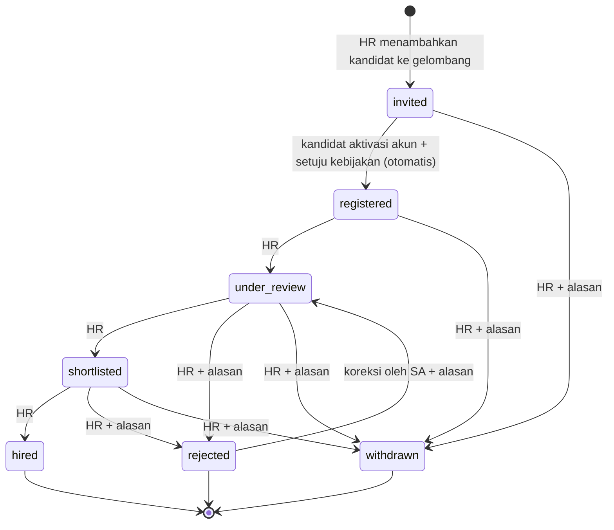

- Setiap perubahan menulis `application_stage_histories` (siapa, kapan, dari, ke, alasan) dan `activity_logs`.
- Transisi yang tidak ada di diagram ditolak oleh enum (`RecruitmentStage::canTransitionTo()`).
- Kandidat yang sudah `registered` di satu gelombang dan ditambahkan ke gelombang baru langsung berada di `registered` untuk lamaran baru (akun sudah aktif).
- Gelombang `closed` menolak perubahan tahap kecuali oleh SA.

### 10.2 Attempt ujian

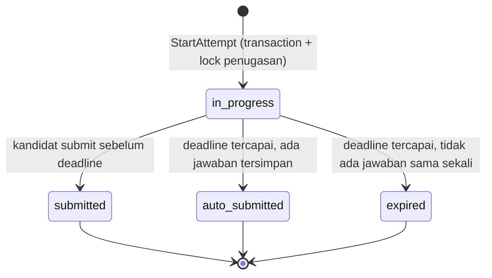

- `expired` tetap dihitung sebagai satu percobaan dan bernilai 0; dibedakan agar HR tahu kandidat tidak mengerjakan apa pun.
- Auto-submit dipicu oleh (1) job `CloseExpiredAttempts` setiap menit dan (2) pengecekan di setiap endpoint attempt.
- "Belum dimulai" adalah penugasan tanpa attempt, bukan status attempt.

### 10.3 Penilaian dan hasil

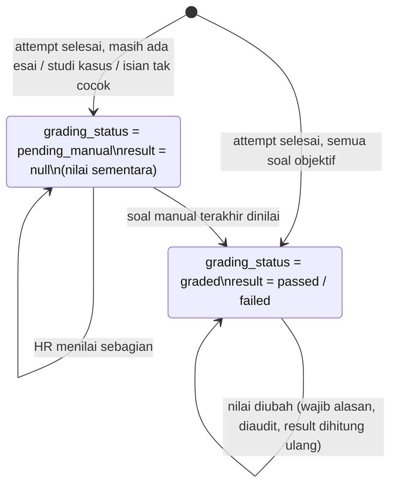

Publikasi ke kandidat dikendalikan terpisah oleh `result_release` ujian:

| Kebijakan     | Kandidat melihat nilai ketika                                        |
| ------------- | -------------------------------------------------------------------- |
| `immediate`   | attempt `graded` (sebelum itu: "menunggu penilaian")                 |
| `after_close` | attempt `graded` **dan** waktu tutup ujian (termasuk override) lewat |
| `manual`      | attempt `graded` **dan** HR menekan "Publikasikan hasil"             |

Kunci jawaban dan pembahasan hanya dikirim jika nilai sudah boleh dilihat **dan** `show_review = true`.

## 11. Alur kerja HR dan kandidat

### 11.1 HR

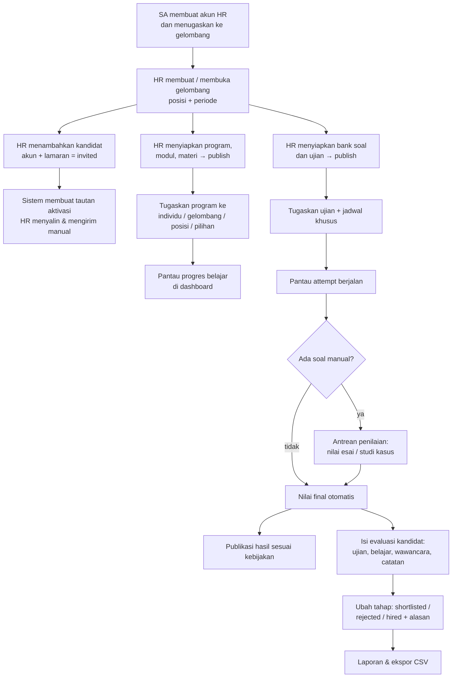

### 11.2 Kandidat

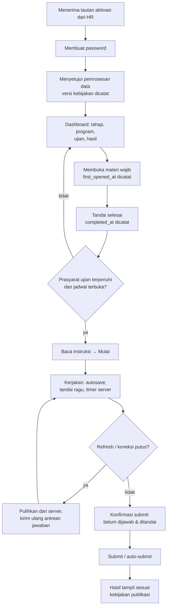

## 12. Aturan bisnis yang diturunkan

Aturan ini tidak ditulis eksplisit di `rules.md`, tetapi diperlukan agar implementasi konsisten.

| No  | Aturan                                                                                                                                                                                                                                                  |
| --- | ------------------------------------------------------------------------------------------------------------------------------------------------------------------------------------------------------------------------------------------------------- |
| B1  | Nomor kandidat: `CAND-{YYYY}-{6 digit urut}`, dibuat di dalam transaction dengan lock pada baris counter per tahun.                                                                                                                                     |
| B2  | Satu email = satu akun. Menambahkan email yang sudah terdaftar sebagai kandidat ke gelombang lain membuat lamaran baru, bukan akun baru.                                                                                                                |
| B3  | Menonaktifkan kandidat: login ditolak, attempt `in_progress` langsung di-auto-submit, data tetap ada.                                                                                                                                                   |
| B4  | Jadwal efektif penugasan ujian = override per individu jika ada, jika tidak = jadwal ujian. `deadline_at = min(started_at + durasi, waktu tutup efektif)`.                                                                                              |
| B5  | Jumlah percobaan efektif = `max_attempts_override` ?? `exams.max_attempts`. Attempt `expired` ikut dihitung.                                                                                                                                            |
| B6  | Prasyarat: semua materi **wajib** dari setiap program prasyarat harus `completed` pada saat mulai ujian.                                                                                                                                                |
| B7  | Ujian hanya bisa ditugaskan dan dimulai jika `status = published`. Ujian `archived` tidak bisa dimulai, tetapi attempt lama tetap terlihat.                                                                                                             |
| B8  | Ujian terkunci saat attempt pertama dibuat (`locked_at`). Setelah itu soal dan bobot tidak bisa diubah; judul, deskripsi, jadwal, dan kebijakan publikasi masih boleh diubah.                                                                           |
| B9  | Isian singkat dinormalisasi: trim, gabungkan spasi berlebih, huruf kecil (`mb_strtolower`). Tidak cocok → `pending_manual`, bukan otomatis 0.                                                                                                           |
| B10 | Multi-select parsial: `max(0, (benar_dipilih − salah_dipilih) / jumlah_benar) × poin`.                                                                                                                                                                  |
| B11 | Studi kasus: soal induk hanya berisi teks kasus (0 poin); poin ada di sub-soal; sub-soal dinilai sesuai jenisnya.                                                                                                                                       |
| B12 | Satu sesi aktif per attempt: saat runner dibuka, token sesi baru disimpan (hash). Permintaan dari token lama ditolak dengan pesan "ujian dibuka di perangkat/tab lain" dan dicatat sebagai `session_replaced`.                                          |
| B13 | Autosave memakai `client_revision` per jawaban; server hanya menerima revisi yang lebih baru, sehingga antrean kirim ulang tidak menimpa jawaban yang lebih baru.                                                                                       |
| B14 | Navigasi `forward_only`: server menolak penyimpanan untuk soal sebelum posisi terjauh yang sudah dilewati.                                                                                                                                              |
| B15 | Retensi: job harian menganonimkan data pribadi kandidat yang **semua** lamarannya berada di gelombang yang ditutup > 12 bulan (nama → "Kandidat Anonim", email/telepon dihapus, catatan internal & jawaban esai teks dihapus); nilai dan agregat tetap. |
| B16 | Permintaan penghapusan disetujui SA → proses anonimisasi yang sama dijalankan segera; ditolak → wajib alasan.                                                                                                                                           |

## 13. Risiko teknis dan keamanan

| No  | Risiko                                                             | Dampak                             | Mitigasi                                                                                                                                                                                                   |
| --- | ------------------------------------------------------------------ | ---------------------------------- | ---------------------------------------------------------------------------------------------------------------------------------------------------------------------------------------------------------- |
| R1  | Dua klik "Mulai" bersamaan membuat dua attempt                     | Jatah percobaan terpakai ganda     | Transaction + `lockForUpdate()` pada baris `exam_assignments`; unique `active_assignment_id`; tes konkurensi.                                                                                              |
| R2  | Submit ganda (klik ganda, job + kandidat bersamaan)                | Penilaian ganda / nilai berubah    | `SELECT ... FOR UPDATE` pada attempt, proses hanya jika `in_progress`, respons idempotent; tes submit paralel.                                                                                             |
| R3  | Manipulasi jam klien untuk menambah waktu                          | Ketidakadilan                      | Server menjadi satu-satunya sumber waktu; penyimpanan ditolak setelah `deadline_at`; klien hanya menampilkan sisa waktu dari `deadline_at − server_now`.                                                   |
| R4  | Kunci jawaban bocor lewat props/JSON                               | Ujian tidak valid                  | Resource terpisah untuk kandidat (`CandidateQuestionResource`) yang tidak memiliki field kunci; tes yang memeriksa respons tidak memuat `is_correct`, `accepted_answers`, `explanation` sebelum publikasi. |
| R5  | Soal/pilihan bisa dicocokkan antar-kandidat lewat ID               | Kerja sama curang                  | Token acak per attempt untuk soal dan pilihan; urutan acak disimpan di snapshot.                                                                                                                           |
| R6  | IDOR: kandidat/HR mengakses data di luar haknya dengan menebak URL | Kebocoran data pribadi             | ULID `public_id`; Policy + scope `visibleTo()` di semua query; data di luar lingkup → 404; tes per sel matriks.                                                                                            |
| R7  | ID internal bocor di props Inertia                                 | Enumerasi data                     | Hanya Resource yang boleh dikirim; tes otomatis yang memindai props/JSON untuk kunci `id` numerik dan `*_id`.                                                                                              |
| R8  | XSS lewat artikel, soal, catatan                                   | Pembajakan sesi HR                 | Sanitasi HTML di server saat simpan (allowlist); teks biasa dirender tanpa `dangerouslySetInnerHTML`; header CSP dasar.                                                                                    |
| R9  | Unggahan berbahaya (file disamarkan, ukuran besar)                 | Eksekusi kode / DoS                | Validasi MIME sebenarnya + ekstensi + ukuran; disk privat di luar `public/`; nama file acak; disajikan lewat controller dengan `Content-Disposition` dan `X-Content-Type-Options: nosniff`.                |
| R10 | Unggahan video 200 MB melebihi batas PHP/Nginx                     | Unggahan gagal                     | Dokumentasikan `upload_max_filesize`, `post_max_size`, `client_max_body_size`; tampilkan progres unggah; validasi ukuran di klien sebagai kenyamanan.                                                      |
| R11 | Job auto-submit tidak jalan (cron mati)                            | Attempt menggantung                | Pengecekan kedaluwarsa saat akses sebagai cadangan; laporan "attempt melewati deadline" di dashboard SA.                                                                                                   |
| R12 | Lalu lintas autosave tinggi saat ujian massal                      | Beban database                     | Debounce 2 detik, satu baris per soal (`upsert`), rate limit per attempt, index tepat.                                                                                                                     |
| R13 | Brute force login / penebakan token aktivasi                       | Pengambilalihan akun               | Rate limit Fortify; token aktivasi acak, di-hash, kedaluwarsa 72 jam, sekali pakai; 2FA untuk SA/HR.                                                                                                       |
| R14 | Kehilangan jawaban karena koneksi putus                            | Kandidat dirugikan                 | Antrean jawaban di `localStorage` per attempt + kirim ulang otomatis; indikator status simpan; status dipulihkan dari server saat refresh.                                                                 |
| R15 | Perhitungan nilai tidak konsisten antar-tempat                     | Laporan berbeda dari layar         | Satu kelas `ScoreCalculator`; nilai disimpan di attempt saat final; laporan membaca nilai tersimpan, tidak menghitung ulang.                                                                               |
| R16 | Kebocoran data pribadi melalui ekspor                              | Pelanggaran UU PDP                 | Ekspor mengikuti scope HR; file di disk privat; unduhan hanya oleh peminta; kedaluwarsa 7 hari; dicatat di audit log.                                                                                      |
| R17 | Retensi/anonimisasi menghapus data yang masih dibutuhkan           | Laporan rusak                      | Anonimisasi hanya mengubah kolom pribadi; nilai dan relasi tetap; dijalankan per batch dengan audit log; tes khusus.                                                                                       |
| R18 | MySQL 5.7 di dev berbeda dengan versi produksi                     | Bug yang hanya muncul di produksi  | Hindari fitur khusus MySQL 8; CI menjalankan tes di versi produksi saat ditentukan.                                                                                                                        |
| R19 | Zona waktu salah (UTC vs Asia/Jakarta) pada jadwal ujian           | Ujian buka/tutup di jam yang salah | Input jadwal di form diinterpretasikan sebagai Asia/Jakarta lalu dikonversi ke UTC di Form Request; tes batas waktu dengan `travelTo()`.                                                                   |

## 14. Rencana implementasi bertahap

Setiap tahap diakhiri dengan Definition of Done di `rules.md` Bagian 17 (`migrate:fresh --seed`, `php artisan test`, `npm run test`, `npm run build`, `tsc --noEmit`, Pint, `vp check`) lalu berhenti untuk persetujuan.

| Tahap | Ruang lingkup                                                                                                                                                                                                                                                                                                                                                    | Keluaran yang bisa dicoba                              |
| ----- | ---------------------------------------------------------------------------------------------------------------------------------------------------------------------------------------------------------------------------------------------------------------------------------------------------------------------------------------------------------------- | ------------------------------------------------------ |
| 1     | Dokumen ini.                                                                                                                                                                                                                                                                                                                                                     | —                                                      |
| 2     | Semua migration, model, relasi, enum, factory; trait `HasPublicId`; seeder produksi (role + SA dari env) dan seeder demo; kolom generated untuk attempt aktif; tes skema (unique constraint, relasi).                                                                                                                                                            | `migrate:fresh --seed` menghasilkan data demo lengkap. |
| 3     | Role pada user, middleware role/aktif/consent, Policy dasar + scope `visibleTo`, aktivasi kandidat, halaman persetujuan, layout HR (sidebar) & kandidat, peta ikon, kamus i18n, komponen dasar (tabel server-side, badge status, empty/error/loading state, dialog konfirmasi), Vitest + RTL disiapkan. Tes matriks akses dasar dan tes "tidak ada ID internal". | Login sebagai tiga role dengan navigasi masing-masing. |
| 4     | Departemen & posisi, gelombang + penugasan HR, kandidat + lamaran, tahap + riwayat, catatan internal, form evaluasi.                                                                                                                                                                                                                                             | HR mengelola gelombang dan kandidat.                   |
| 5     | Program, modul, materi (semua jenis), unggah file privat + URL bertanda tangan, penugasan program, progres kandidat, halaman belajar kandidat.                                                                                                                                                                                                                   | Kandidat belajar dan progres tercatat.                 |
| 6     | Kategori & bank soal (6 jenis, versioning), ujian (konfigurasi, soal, bobot, kunci, duplikasi), penugasan ujian + jadwal khusus.                                                                                                                                                                                                                                 | HR membuat dan menugaskan ujian.                       |
| 7     | Mesin attempt (start, snapshot, state, autosave, clock, events, submit, auto-submit job), runner React (timer, navigasi, tandai ragu, antrean simpan, konfirmasi submit), grader per jenis soal, nilai berbobot & per kategori, antrean penilaian manual, kebijakan percobaan & publikasi, halaman hasil.                                                        | Alur ujian lengkap end-to-end.                         |
| 8     | Dashboard HR (agregasi DB, filter) dan dashboard kandidat.                                                                                                                                                                                                                                                                                                       | Dashboard dengan angka nyata.                          |
| 9     | Laporan, ekspor CSV lewat queue, daftar & unduhan ekspor, audit log.                                                                                                                                                                                                                                                                                             | Laporan dan ekspor sesuai lingkup.                     |
| 10    | Hardening (CSP, header keamanan, rate limit, sesi), retensi & anonimisasi, permintaan penghapusan data, tes E2E Playwright, README lengkap, panduan deployment.                                                                                                                                                                                                  | Siap uji penerimaan.                                   |

Tahap 7 adalah yang terbesar dan paling berisiko; jika terlalu besar untuk satu kali tinjau, akan dipecah menjadi 7a (mesin attempt + runner) dan 7b (penilaian + publikasi), dengan persetujuan Anda.

## 15. Keputusan yang perlu dikonfirmasi

Hanya keputusan yang memengaruhi alur bisnis. Jika tidak ada jawaban, default di kolom kanan dipakai.

| No  | Pertanyaan                                                                                                                              | Default yang dipakai                                                                        |
| --- | --------------------------------------------------------------------------------------------------------------------------------------- | ------------------------------------------------------------------------------------------- |
| K1  | Tanpa email di MVP, bagaimana kandidat menerima akses? Tautan aktivasi yang disalin HR, atau password sementara yang ditampilkan ke HR? | **Tautan aktivasi** (berlaku 72 jam, sekali pakai). HR tidak pernah tahu password kandidat. |
| K2  | Apakah HR boleh membuat gelombang baru sendiri, atau hanya Super Admin?                                                                 | **HR boleh**, dan otomatis ditugaskan ke gelombang yang dibuatnya.                          |
| K3  | Kriteria evaluasi kandidat: cukup lima kriteria tetap (ujian, belajar, wawancara, sikap, lainnya) dengan skor 1–5?                      | **Ya**, lima kriteria tetap + rekomendasi akhir 4 tingkat.                                  |

## 16. Riwayat perubahan

| Tanggal    | Perubahan                                                                                                                                                                                                                                                                                                                                                                                                                                                                                                 |
| ---------- | --------------------------------------------------------------------------------------------------------------------------------------------------------------------------------------------------------------------------------------------------------------------------------------------------------------------------------------------------------------------------------------------------------------------------------------------------------------------------------------------------------- |
| 2026-10-28 | Versi awal Tahap 1                                                                                                                                                                                                                                                                                                                                                                                                                                                                                        |
| 2026-10-28 | Tahap 2: soft delete dihapus dari rancangan (diganti `is_active`, anonimisasi, arsip). Model `User` tetap di `app/Models` karena dipakai Fortify; model lain di `app/Domain/<Domain>/Models`. Tambahan kolom: `questions.position` (urutan sub-soal studi kasus), `exam_attempts.furthest_position` dan `navigation` (aturan B14), `activity_logs.user_agent`, `report_exports.error_message`. Tabel tambahan `candidate_number_sequences` (aturan B1). ULID disimpan dalam huruf kecil (bawaan Laravel). |
| 2026-10-28 | Tahap 3: token aktivasi disimpan di tabel terpisah `account_activation_tokens` agar tidak bentrok dengan token reset password. Komponen tabel server-side (sorting + pagination) dipindah ke Tahap 4 bersama halaman daftar pertama yang memakainya. Penghapusan akun mandiri bawaan starter kit dihapus; kandidat tidak dapat mengubah email sendiri. Halaman `/` dialihkan ke `/dashboard`.                                                                                                             |
| 2026-10-28 | Tahap 6: pilihan jawaban disimpan dan ditampilkan sebagai teks biasa (bukan HTML). Bobot studi kasus di ujian = jumlah bobot sub-soal dan tidak dapat diubah per ujian. Saat soal mendapat versi baru, ujian yang belum terkunci otomatis dialihkan ke versi baru (bukan ditawarkan). Pemilih soal ujian memakai endpoint JSON khusus HR tanpa kunci jawaban.                                                                                                                                             |
